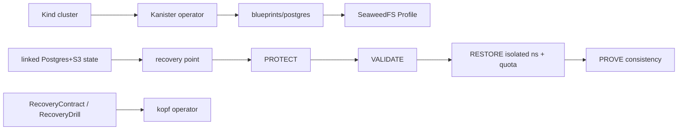

# Kanister Recovery Contract

Restore should be proved, not assumed.

<p align="center">
  
</p>

[](https://github.com/justrunme/kanister-backup-restore/actions/workflows/ci.yml)
[](https://github.com/justrunme/kanister-backup-restore/releases/latest)
[](LICENSE)
[](https://justrunme.com/cases/kanister-backup-restore/)
[](https://securityscorecards.dev/viewer/?uri=github.com/justrunme/kanister-backup-restore)

Case study: [Kanister Backup & Restore](https://justrunme.com/cases/kanister-backup-restore/) · [Andrey Lesnikov](https://justrunme.com/)

## What it does

- Multi-service Application Recovery Contract for **Postgres + S3** (SeaweedFS/MinIO) on Kind
- Linked demo state: DB rows reference object keys with sha256 + generation under one logical recovery point
- PROVE requires component restore **and** cross-component consistency (objects exist, checksums match, generation aligned, bounded RP skew)
- CRDs `RecoveryContract` / `RecoveryDrill` with a lightweight kopf operator; drills run in isolated namespaces with ResourceQuota/LimitRange
- Binary PROVED / UNPROVED verdicts + Prometheus metrics (`verdict`, `rto_seconds`, `last_success_timestamp`)

Solr is out of scope for now (listed under `future` in the contract).

## Why

- A successful backup job is not proof of application recoverability
- Restoring Postgres alone while losing referenced objects is still an application outage

## Quickstart

```bash
make full-drill
```

## Architecture



## Recovery Contract

```text
RECOVERY CONTRACT
Artifact integrity              required
Isolated restore                required
Application ready               required
Data verification               required
Cross-component consistency     required
RTO                             < 60s
Evidence freshness              < 24h
Recovery-point skew             < 60s
```

Evidence: `.evidence/recovery-verdict.md` + `.evidence/recovery-verdict.json`

---

## Why this exists

A VolumeSnapshot preserves bytes.  
Application recovery needs logical order, secrets/context, artifact validation, an isolated drill, and evidence.

This pack runs that path for real: Kind, Kanister, MinIO Profile, `pg_dump`, `kando location push/pull`, gzip validation, isolated restore namespace, recovery markers — then evaluates the **contract**.

---

## Quickstart

```bash
make full-drill
```

---

## Failure drills

Show which failure modes make a backup untrustworthy:

```bash
make failure-drill SCENARIO=delete-s3-object
make failure-drill SCENARIO=corrupt-s3-object
make failure-drill SCENARIO=mismatched-recovery-points
make failure-drill SCENARIO=noop-restore
make failure-drill SCENARIO=corrupt-artifact
```

| Scenario | Reason | What you learn |
|---|---|---|
| `delete-s3-object` | `cross_component_consistency` | Postgres restore ≠ application recoverability |
| `corrupt-s3-object` | `cross_component_consistency` | Checksums must match across components |
| `mismatched-recovery-points` | `cross_component_consistency` | One logical RP required |
| `corrupt-artifact` | `artifact_integrity` | Creation ≠ recoverability |
| `noop-restore` | `data_verification` | A completed ActionSet is not proof |

---

## Make targets

| Target | Purpose |
|---|---|
| `make full-drill` | Kind + Kanister + MinIO + happy-path prove |
| `make recovery-drill` | PROTECT → VALIDATE → RESTORE → PROVE |
| `make prove` | Re-evaluate latest evidence against the contract |
| `make failure-drill SCENARIO=…` | Inject failure → expect UNPROVED |
| `make evidence` | ActionSet inventory markdown |

---

## Layout

```text
config/recovery-contract.yaml   Contract clauses (no scores)
docs/assets/recovery-lifecycle.svg
scripts/recovery-drill.sh       Prove loop
scripts/evaluate-contract.sh    PROVED | UNPROVED
scripts/failure-drill.sh        Failure injection entrypoint
scripts/break.sh                Scenario arming
blueprints/postgres/            Real pg_dump + kando push/pull
.evidence/                      Drill JSON + verdict
```

---

## Philosophy

| Project | Prove |
|---|---|
| Architecture Rehearsal | the change |
| TwinOps | state convergence |
| AI Infra Control Plane | governance decisions |
| **This repo** | **recovery before the incident** |

Assumptions → evidence.

---

## Demo

Recovery drill on kind: backup → validate → isolated restore → prove (and a deliberate corrupt-artifact failure path).

```bash
make full-drill
make failure-drill SCENARIO=corrupt-artifact
```

<p align="center">
  
</p>

## Results

Measured from Recovery Drill CI (not estimates). Details: [docs/results.md](docs/results.md) · [docs/results.json](docs/results.json).

| Metric | k8s v1.37.0 | k8s v1.36.4 | Source |
| --- | ---: | ---: | --- |
| RTO (restore duration) | **16 s** | **16 s** | [38061727612](https://github.com/justrunme/kanister-backup-restore/actions/runs/38061727612) |
| RPO | 26 s | 25 s | same run artifacts |
| Happy-path verdict | **PROVED** | **PROVED** | `recovery-evidence-k8s-*` |
| Failure `corrupt-artifact` | **UNPROVED** (`artifact_integrity`) | same | same run |

## License

Apache-2.0 © Andrey Lesnikov
