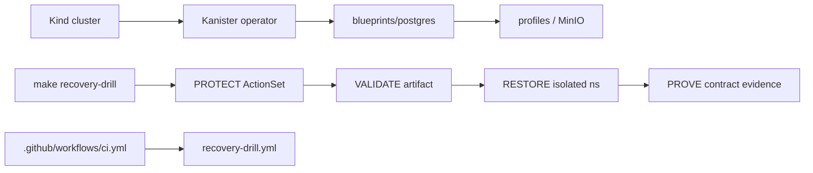

# Kanister Recovery Contract

Restore should be proved, not assumed.

[](https://github.com/justrunme/kanister-backup-restore/actions/workflows/ci.yml)
[](https://github.com/justrunme/kanister-backup-restore/releases/latest)
[](LICENSE)

Case study: [Kanister Backup & Restore](https://justrunme.com/cases/kanister-backup-restore/) · [Andrey Lesnikov](https://justrunme.com/)

## What it does

- Runs a Kanister-based drill: PROTECT → VALIDATE → RESTORE → PROVE on Kind with MinIO
- Evaluates a Recovery Contract (artifact integrity, isolated restore, app ready, RTO/freshness)
- Emits binary PROVED / UNPROVED verdicts with evidence under `.evidence/`

## Why

- A successful backup job is not proof of application recoverability
- Volume snapshots preserve bytes; recovery needs ordered restore, validation, and measured RTO

## Quickstart

```bash
make full-drill
```

## Architecture



## Recovery Contract

```text
RECOVERY CONTRACT
Artifact integrity       required
Isolated restore         required
Application ready        required
Data verification        required
RTO                      < 60s
Evidence freshness       < 24h
```

After `make full-drill` (or `make recovery-drill`):

```text
RECOVERY DRILL #0042
Backup                 PASS
Artifact integrity     PASS
Isolated restore       PASS
Application ready      PASS
Recovery marker        PASS
RPO                     3m 41s
RTO                       38s
Evidence age              0m
RECOVERY                 PROVED
```

Evidence: `.evidence/recovery-verdict.md` + `.evidence/recovery-verdict.json`

---

## Why this exists

A VolumeSnapshot preserves bytes.  
Application recovery needs logical order, secrets/context, artifact validation, an isolated drill, and evidence.

This pack runs that path for real: Kind, Kanister, MinIO Profile, `pg_dump`, `kando location push/pull`, gzip validation, isolated restore namespace, recovery markers — then evaluates the **contract**.

---

## Quickstart

```bash
make full-drill
```

---

## Failure drills

Show which failure modes make a backup untrustworthy:

```bash
make failure-drill SCENARIO=corrupt-artifact
make failure-drill SCENARIO=wrong-secret
make failure-drill SCENARIO=schema-drift
make failure-drill SCENARIO=slow-restore
```

Example (corrupt artifact):

```text
Backup                 PASS
Artifact integrity     FAIL
Isolated restore       BLOCKED
RECOVERY               UNPROVED
Reason                 artifact_integrity
```

| Scenario | Reason | What you learn |
|---|---|---|
| `corrupt-artifact` | `artifact_integrity` | Creation ≠ recoverability |
| `wrong-secret` | `isolated_restore` | Credentials are part of the contract |
| `schema-drift` | `data_verification` | Bytes restored ≠ application verified |
| `slow-restore` | `rto` | Success without RTO still UNPROVED |

---

## Make targets

| Target | Purpose |
|---|---|
| `make full-drill` | Kind + Kanister + MinIO + happy-path prove |
| `make recovery-drill` | PROTECT → VALIDATE → RESTORE → PROVE |
| `make prove` | Re-evaluate latest evidence against the contract |
| `make failure-drill SCENARIO=…` | Inject failure → expect UNPROVED |
| `make evidence` | ActionSet inventory markdown |

---

## Layout

```text
config/recovery-contract.yaml   Contract clauses (no scores)
docs/assets/recovery-lifecycle.svg
scripts/recovery-drill.sh       Prove loop
scripts/evaluate-contract.sh    PROVED | UNPROVED
scripts/failure-drill.sh        Failure injection entrypoint
scripts/break.sh                Scenario arming
blueprints/postgres/            Real pg_dump + kando push/pull
.evidence/                      Drill JSON + verdict
```

---

## Philosophy

| Project | Prove |
|---|---|
| Architecture Rehearsal | the change |
| TwinOps | state convergence |
| AI Infra Control Plane | governance decisions |
| **This repo** | **recovery before the incident** |

Assumptions → evidence.

---

## License

Apache-2.0 © Andrey Lesnikov
